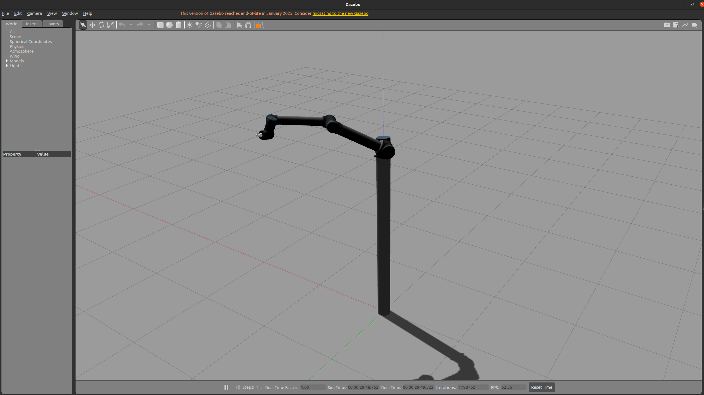
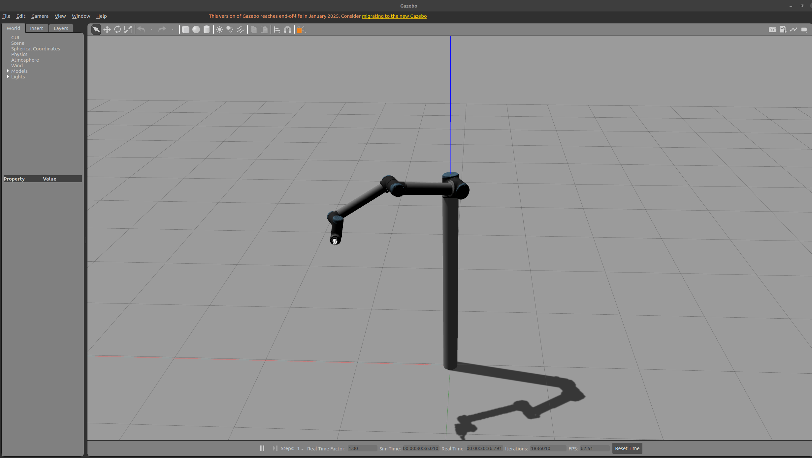
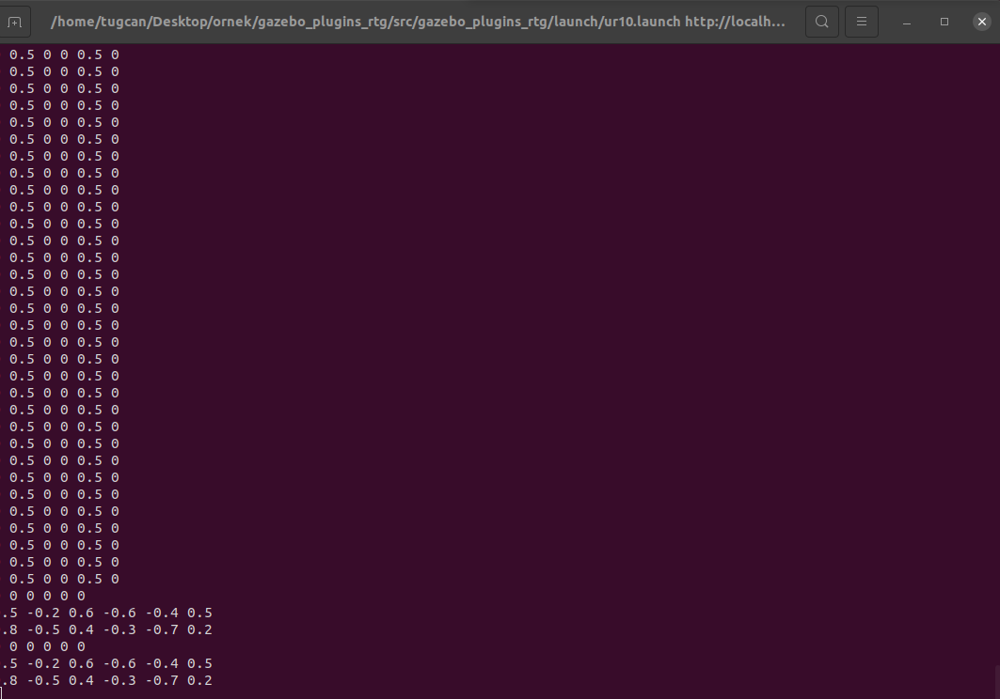
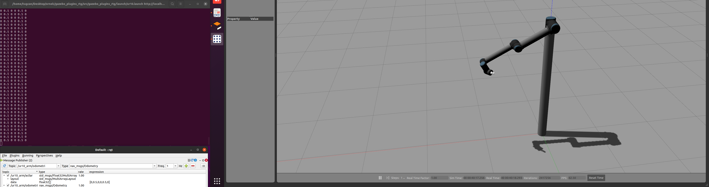
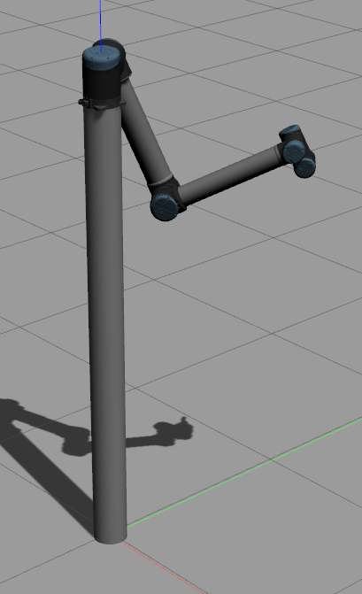
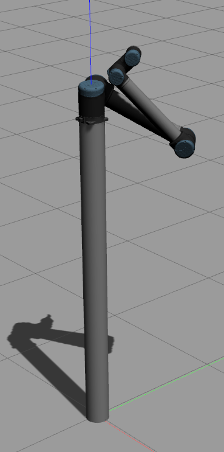
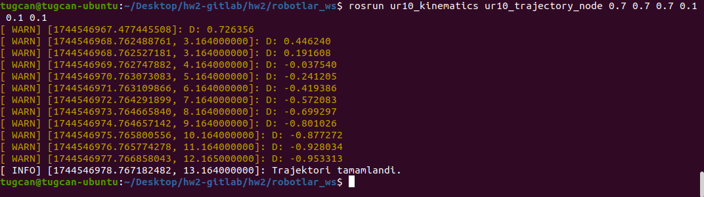

# Robot Arm Kinematics and Trajectory Examples

ROS1 Noetic C++ coursework for a UR10 arm in Gazebo. `robotlar_ws/src/ur10_kinematics` contains a forward/inverse kinematics library, a demonstration node and a position-only trajectory node.

The tracked `build` and `devel` trees are original Linux workspace snapshots. Their binaries and paths are not portable. Build the maintained package in a fresh workspace; the tracked workspace `src/CMakeLists.txt` contains the original catkin path rather than a portable top-level build file.

## Requirements and build

Use Linux with ROS1 Noetic, catkin, Eigen3, `roscpp`, `std_msgs`, `nav_msgs` and `tf`. Install the course's [gazebo_plugins_rtg package](https://gitlab.com/blm6191_2425b_tai/blm6191/gazebo_plugins_rtg) separately for the robot model, simulation and `/ur10_arm/acilar` subscriber. The original assignment repository is [hw2 on GitLab](https://gitlab.com/blm6191_2425b_tai/members/24501118/hw2).

```bash
source /opt/ros/noetic/setup.bash
git clone https://github.com/tugcantopaloglu/robot-arm-trajectory-and-rotation-ros.git
mkdir -p ~/arm_ws/src
cp -R robot-arm-trajectory-and-rotation-ros/robotlar_ws/src/ur10_kinematics ~/arm_ws/src/
cd ~/arm_ws
rosdep install --from-paths src --ignore-src -r -y
catkin_make
source devel/setup.bash
```

Install `gazebo_plugins_rtg` in this workspace or source its underlay. Start the simulation in a separate sourced terminal:

```bash
roslaunch gazebo_plugins_rtg ur10.launch
```

Unpause Gazebo if the model starts paused. Wait for the simulator's command subscriber before running either example.

## Run the examples

The demonstration publishes sample joint angles, reads `/ur10_arm/odometri`, and prints theoretical and observed poses:

```bash
rosrun ur10_kinematics ur10_kinematics_node
```

The trajectory executable requires exactly six coordinates, in meters: `x0 y0 z0 x1 y1 z1`.

```bash
rosrun ur10_kinematics ur10_trajectory_node 0.7 0.7 0.7 0.1 0.1 0.1
```

It samples a straight line at intervals of at most 0.1 meter and publishes one six-angle command per second. Identical endpoints produce one command. All arguments and waypoints are validated before any command is published. Invalid, nonfinite or unreachable coordinates exit with an error. ROS remapping arguments are excluded from the coordinate count. The node waits up to five wall-clock seconds for the arm command subscriber before publishing and exits with an error if none connects.

The bundled launch starts Gazebo and passes those six coordinates as arguments. Override any coordinate with a launch argument:

```bash
roslaunch ur10_kinematics trajectory.launch x0:=0.6 y0:=0.5 z0:=0.5 x1:=0.2 y1:=0.2 z1:=0.2
```

The trajectory uses the existing simplified position-only geometric solver with its last three wrist angles fixed at zero. Its dimensions differ from the demonstration library's DH table. The coursework does not check collision clearance, joint limits, Cartesian orientation or equivalence with a physical UR10 model. The demonstration skips observed-pose comparisons and inverse kinematics examples until simulator odometry has arrived.

## Regression checks and limits

```bash
g++ -std=c++11 -Wall -Wextra -Werror robotlar_ws/src/ur10_kinematics/test/trajectory_test.cpp -o /tmp/trajectory_test
/tmp/trajectory_test
```

The standalone test checks numeric parsing, stationary trajectories, endpoint inclusion, interval size, finite six-angle commands and rejection of unreachable paths before execution. In a built catkin workspace, run `ctest --test-dir build -R trajectory_test --output-on-failure`. These checks do not validate the Eigen kinematics library, ROS transport, the Gazebo model or real hardware. Full acceptance requires ROS, Eigen3, the external model package and simulation.

## Original assignment screenshots

These images record the original experiment and are not results from the standalone test.








